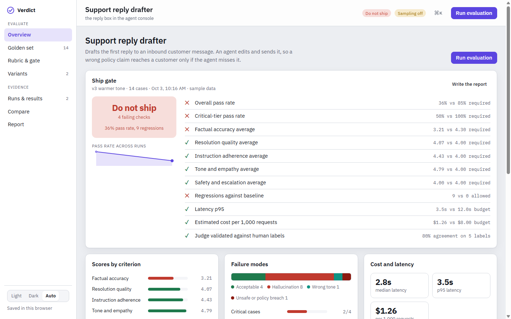

# Verdict — an AI feature quality console

Verdict is an eval workbench for a single LLM-powered feature. It holds the golden
set, the rubric, the prompt variants under test, and the ship gate, then turns a
run into a decision: **ship it**, **needs review**, or **do not ship**.



It ships with a worked example — a customer-support reply drafter with 14 labeled
cases, a five-criterion rubric, and two prompt variants — so the console has
something to show before you run anything.

## Why it exists

Most teams change a prompt, read a handful of outputs, and ship. Verdict makes the
quality bar explicit before the run, and makes the judge itself something you have
to validate.

Three decisions the tool encodes:

1. **A case passes only when every criterion clears its own minimum.** A strong
   average cannot hide one disqualifying failure.
2. **Regressions block, latency and cost warn.** Hard gates and soft gates are
   separated, so a slow-but-correct candidate is reviewed rather than rejected.
3. **The LLM judge is a measurement instrument, so it gets measured.** You label a
   sample by hand; agreement between your labels and the judge is its own gate
   check. Until enough labels exist, the pass rate is reported as provisional.

## Running it

Open `index.html` in a browser (or download it from this repo). It is one
self-contained file: React is inlined, there is no server, and data is kept in
`localStorage`.

In a plain browser you can explore the sample project, edit the golden set, rubric,
gate and variants, label results, compare runs and export the report. Live runs
need model access, so the top bar shows **Sampling off** and **Run evaluation**
explains why it can't start.

Hosted on claude.ai, the same file uses the artifact runtime instead: shared
storage for the workspace and runs, live model calls for generating and grading,
and file downloads for the exports.

## Build

```
npm install
npm run build      # -> index.html and dist/verdict.html
```

`index.html` is committed so the app can be opened straight from the repo; rebuild
and commit it after changing anything in `src/`.

`build.mjs` compiles the JSX with Babel and inlines React, the stylesheet and the
app into one HTML file. There is no bundler: the sources share one scope and are
concatenated in order.

```
src/domain.js   pure logic — stats, gate checks, verdict, report markdown
src/demo.js     the sample project
src/store.js    persistence, sampling, the run engine
src/ui.jsx      primitives — dialog, drawer, command palette, charts
src/views.jsx   the seven pages
src/App.jsx     shell, navigation, keyboard
```

## Method

Each case is sent to the variant under test, then graded by an LLM judge against
the rubric on a 1–5 scale with written anchors for 1, 3 and 5. Two model calls per
case. Scores roll up to a pass rate, per-criterion means, failure-mode counts, a
p95 latency figure, and an estimated cost per 1,000 requests.

## Exports

- `docs/eval-report.md` — the gate, the numbers, the regressions, the method
- `eval-results.csv` — one row per case with scores, rationale and your labels
- `golden-set.jsonl` — the labeled cases, so the set outlives the tool
